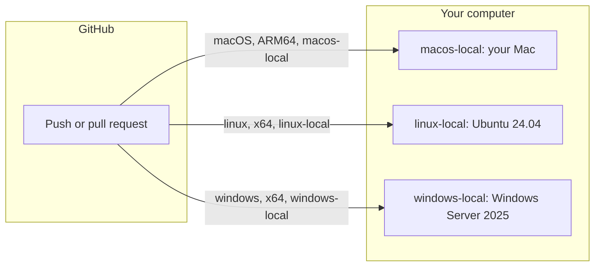

Private repositories spend the hosted-runner minutes in your GitHub plan.
Standard GitHub-hosted runners are free for public repositories. When a
private build is Linux, Windows, or macOS, the computer already on your desk
can run it without using those hosted-runner minutes.

GitHub ships the program that does this. You register it with your
organization, give it a label, and change `runs-on` for the jobs that should
land there. The pages below walk through that once, then through a Mac, a
Linux machine, and a Windows virtual machine. Together those three cover the
same jobs GitHub's hosted runners cover.

A hosted job is a fresh computer of one operating system. Ubuntu jobs go to
an Ubuntu machine, Windows jobs to a Windows machine, and macOS jobs to a Mac.
A self-hosted runner works the same way. The program runs the steps on the
operating system where you installed it, so you install one runner for each
operating system you want. On a Mac, that is the Mac itself, a Linux VM or an
Ubuntu container beside it, and a Windows VM beside that. A hosted macOS
minute costs about ten times a standard two-core Linux minute.
[GitHub does not charge for self-hosted runner usage](https://docs.github.com/en/billing/concepts/product-billing/github-actions),
though your hardware, electricity, and any billable artifact or cache storage
still have a cost.



## Register the runner

The registration is the same on every machine. In the organization settings,
open Actions, then Runners, then New runner, then New self-hosted runner. Pick
the operating system and the chip. GitHub prints a download and a configure
command. The token in that command lasts an hour, so run it while the page is
open. Add your own label with `--labels`. The examples here are
`macos-local`, `linux-local`, and `windows-local`. The label is how a workflow
asks for this machine, rather than every self-hosted runner you add later.

<div class="article-table" role="region" aria-label="Article data table" tabindex="0">

| Runner | Where it runs | A job asks for |
|---|---|---|
| `macos-local` | Your Mac, macOS 11 or later | `[self-hosted, macOS, ARM64, macos-local]` |
| `linux-local` | Ubuntu, on the host or in a VM | `[self-hosted, linux, x64, linux-local]` |
| `windows-local` | A Windows VM | `[self-hosted, windows, x64, windows-local]` |

</div>

Leave the runners in the default group. Private repositories can use that
group. Keep public repositories on GitHub's runners. The runner executes the
repository's code on your computer, and a pull request opened from a fork of
a public repository can start that code.

The download and the exact commands are on [Adding self-hosted runners](https://docs.github.com/en/actions/how-tos/manage-runners/self-hosted-runners/add-runners).
The switch for public repositories is on [Managing access with runner groups](https://docs.github.com/en/actions/how-tos/manage-runners/self-hosted-runners/manage-access).

The archive GitHub gives you already contains `config.sh` and `run.sh`. On
Windows those names end in `.cmd`. When `config.sh` finishes, it writes
`svc.sh` into the same directory from a template in the archive. You run
GitHub's scripts. `./run.sh` starts the runner in a terminal so you can watch
it connect. `./svc.sh` registers it to start with the machine.

## On a Mac

For a lot of people, the computer on the desk is a Mac. GitHub supports the
runner on macOS 11 and later. On the New runner page, choose macOS and the
chip in the machine, Apple silicon or Intel. Apple silicon receives the
`ARM64` label. An Intel Mac receives `x64`. GitHub also adds `macOS`.

```yaml
jobs:
  mac-tests:
    runs-on: [self-hosted, macOS, ARM64, macos-local]
```

On an Intel Mac, put `x64` where that example says `ARM64`.

From the directory where you unpacked the runner, `./run.sh` is the check that
the program can see GitHub. When the log says it is listening, stop it and
install the service. On a Mac, `./svc.sh` has to run as you. It installs a
LaunchAgent under your home directory.

```bash
./svc.sh install
./svc.sh start
./svc.sh status
```

The agent starts when you log in. Turn on automatic login if the Mac should
pick up jobs after a restart while you are away. macOS sometimes asks for
local-network permission only when the program is in the foreground. If the
runner looks online and jobs still sit in the queue with a network error, run
`./run.sh` once from the desktop, allow the prompt, and start the service
again.

Install Xcode when a job builds for Apple platforms. The Command Line Tools
are enough for git and clang. GitHub's macOS image already has a full Xcode,
so the first Apple build is where a missing tool shows up.

Linux jobs still need a Linux runner. Docker Desktop is a Linux virtual
machine, so that runner can sit on the same Mac. The next section is that
install. Windows jobs need a Windows runner. Parallels, VMware, and UTM can
host the guest. Install GitHub's runner inside it, from the Windows tab, the
same way you just did on the Mac. On Apple silicon the guest is Windows on
ARM. A job that needs 64-bit x64 Windows still needs an Intel machine, or a
hosted Windows runner.

A sleeping Mac holds the queue until it wakes.

## On Linux

If the computer is Ubuntu, or another distribution on GitHub's supported list,
use the Linux tab and install the runner on the host. The service commands on
Linux go through sudo:

```bash
sudo ./svc.sh install
sudo ./svc.sh start
```

Arch is outside that list, so the runner there lives in an Ubuntu 24.04
container. The same container is how a Mac runs Linux jobs. Two details show
up the first time a job needs the machine around the container.

On Linux, `--network host` lets the runner container share the host network.
[Docker Desktop 4.34 and later also supports host networking](https://docs.docker.com/engine/network/drivers/host/)
for Linux containers when you enable it in **Settings → Resources → Network**.
That support covers TCP and UDP; it does not expose the host's network
interfaces directly. Enable it before using `--network host` on Docker
Desktop. Without it, omit the flag and configure the ports your jobs need,
or use a Linux VM when the workflow requires Linux host networking.

A job that starts another container needs the host Docker socket. That socket
is the host daemon, so the job can start and stop containers on the host.
Mount it when the workflow builds images or runs Compose. Keep your home
directory out of the container. Mount the work directory on a host path,
because Compose mounts that host path, not a path that exists only inside the
runner.

This starts the container and names it `linux-runner`. The runner program is
still the one from GitHub's page. Open a shell and paste those commands inside.

```bash
docker run -d --name linux-runner --restart unless-stopped \
  --network host \
  -v /var/run/docker.sock:/var/run/docker.sock \
  -v "$PWD/linux-runner:/actions-runner" \
  ubuntu:24.04 sleep infinity

docker exec -it linux-runner bash
```

`docker stop linux-runner` leaves the registration on GitHub. After a reboot,
start the container again. A sleeping machine holds the queue.

```bash
docker start linux-runner
docker stop linux-runner
```

## On Windows

An MSVC build, a ConPTY terminal test, and a file symlink have to run on
Windows. A cross-compile produces the binary and never executes those tests.

On a Linux host, [`dockurr/windows`](https://github.com/dockurr/windows)
downloads Windows Server 2025 and boots it with KVM. `VERSION=2025` is the
evaluation image. It lasts 180 days. Four cores, 12 GB of RAM, and a 100 GB
disk were enough for that MSVC build and those two tests. Until you set
`USERNAME` and `PASSWORD`, the image signs in as `Docker` with the password
`admin`.

```yaml
services:
  windows:
    image: dockurr/windows
    container_name: windows
    environment:
      VERSION: "2025"
      CPU_CORES: "4"
      RAM_SIZE: "12G"
      DISK_SIZE: "100G"
      USERNAME: "runner"
      PASSWORD: "set-this"
    devices:
      - /dev/kvm
      - /dev/net/tun
    cap_add:
      - NET_ADMIN
    ports:
      - 8006:8006
    volumes:
      - ./windows:/storage
    stop_grace_period: 2m
```

KVM is a Linux device, so this compose file stays on Linux. On a Mac, use the
Windows VM from the Mac section.

Inside the guest, install Git for Windows, the Visual Studio 2022 Build
Tools, OpenSSH, and the runner from GitHub's Windows tab. Accept the offer to
run it as a service. The service account is `NETWORK SERVICE`.

The desktop is at http://127.0.0.1:8006 while the virtual machine is up.
Forward a host port to 22 if you want SSH.

```bash
docker start windows
docker stop windows
```

`docker stop` needs the grace period in the compose file. Two minutes is
enough for the guest to shut down.

The first Windows builds failed on two settings. `git config --system
core.autocrlf false` keeps the line feeds that are in git, so fixture
comparisons match the repository. Developer Mode, plus the right for
`NETWORK SERVICE` to create symbolic links, is what lets a file symlink
succeed. The message when that right is missing is "a file symlink needs
Developer Mode or an elevated shell."

## Point the workflow at the machine

Change `runs-on` before you turn Actions back on for a repository you had
disabled to save minutes. A workflow that still says `ubuntu-latest`,
`windows-latest`, or `macos-latest` runs on GitHub's computers, and the bill
comes back.

```yaml
jobs:
  mac-tests:
    runs-on: [self-hosted, macOS, ARM64, macos-local]
  fast-gates:
    runs-on: [self-hosted, linux, x64, linux-local]
  windows-tests:
    runs-on: [self-hosted, windows, x64, windows-local]
```

`self-hosted` is the first label. GitHub sends the job to a runner that
carries every label in the list. Each runner takes one job at a time. The
Mac, the Linux runner, and the Windows guest can be busy together.

## Watch a job from the terminal

`docker logs` shows what the Linux container picked up. [`gh runner-monitor`](https://github.com/VeyronSakai/gh-runner-monitor)
shows the same thing for every runner in the organization: idle, active, or
offline, the job name, and how long it has been running.

```bash
docker logs --tail 50 linux-runner
gh auth refresh -h github.com -s admin:org
gh extension install VeyronSakai/gh-runner-monitor
gh runner-monitor --org YOUR-ORG
```

The organization view asks for the `admin:org` scope. When you want the
Windows desktop, it is still http://127.0.0.1:8006. The organization's Actions
runner page lists the same machines.

## What the first build finds

GitHub's hosted image already has the tools the workflow calls. A fresh
runner has the operating system and the runner program.

A step that calls `gh` needs `gh` installed in the Ubuntu container, or a
fallback to `curl` and `GH_TOKEN`. Any other CLI the job expects belongs in
the job, with its config in the job's temp directory, because a home directory
from another machine is not in the container. On a Mac, an Apple build needs
Xcode. On Windows, `core.autocrlf false` keeps fixture files identical to
git, and `NETWORK SERVICE` needs the right to create symbolic links.

Run one private repository from the first push through a green build before
you move the rest.
